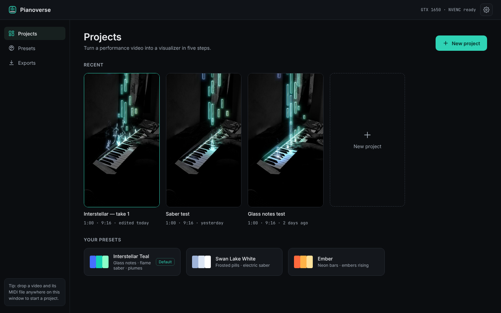
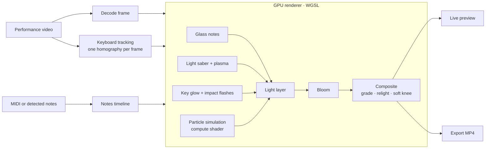

<p align="center">
  
</p>

<p align="center">
  <a href="https://github.com/HetavShah/pianoverse/actions/workflows/build.yml"></a>
  
  
  
  
</p>

<h3 align="center">Film yourself playing. Pianoverse makes the music visible.</h3>

<p align="center">
  Glass notes rain down onto your <b>real</b> keyboard, land on a light saber that flares where you play,<br>
  and every note releases a plume of glitter that curls through the air — all rendered live on your graphics card.
</p>

---

## See it move

<table>
  <tr>
    <td width="40%" align="center"></td>
    <td width="60%" valign="top">

### What happens on screen

**Glass notes** — rounded crystal bars with a bright rim, bevelled edges and a corner glint. Their length is how long you hold the note.

**A light saber on your keys** — a white-hot line traced along the real back edge of your keyboard, with a flickering plasma fringe that flares in the note's colour wherever you play.

**Glitter plumes** — every hit launches streams of fine sparkles that ride a swirling air current, curl into ribbons and fade.

**Real light** — impacts throw coloured light onto your hands and keys, louder notes hit harder, held keys keep glowing, and bass notes make the whole scene breathe.

**Locked to your keyboard** — the camera can move; Pianoverse tracks the keyboard frame by frame so every note lands on the right key.

  </td>
  </tr>
</table>

---

## Five steps from video to visualizer

> Design prototype of the v1 app. The engine already works; these screens are being built next.

<table>
  <tr>
    <td width="50%"><br><b>0 · Projects</b> — your videos and saved looks, one click to start.</td>
    <td width="50%"><br><b>1 · Import</b> — drop in the performance video and the MIDI recorded with it.</td>
  </tr>
  <tr>
    <td width="50%"><br><b>2 · Notes and sync</b> — MIDI lines itself up with the audio automatically; nudge it to the millisecond.</td>
    <td width="50%"><br><b>3 · Calibrate</b> — mark the keyboard once; it is tracked through the whole clip.</td>
  </tr>
  <tr>
    <td width="50%"><br><b>4 · Style</b> — every layer has its own controls, and the preview plays live while you tweak.</td>
    <td width="50%"><br><b>5 · Export</b> — Shorts, landscape or square, encoded on the GPU.</td>
  </tr>
</table>

---

## How it works



A few ideas that make it work:

- **Keyboard-space geometry.** Every key, the saber line and every landing point are defined on the keyboard plane and projected into the frame with that frame's tracked homography, so effects stay glued to the keys even when the camera drifts.
- **Stateless particles.** A particle's position at time *t* is recomputed from the moment its note was hit, inside a compute shader. Any frame can be drawn on its own, which makes scrubbing instant and export identical every time.
- **Light that behaves.** Effects build up in an HDR light layer, get bloom, and are blended with a soft knee, so bright moments glow without blowing out your hands.
- **One engine everywhere.** The same WGSL shaders drive the live preview and the export.

---

## Roadmap

- [x] **Milestone 1 — Engine prototype.** GPU renderer reproduces the approved look on the sample video, live.
- [x] **Milestone 2 — Calibration and tracking.** Mark four corners on any frame, built-in keyboard tracker (drift-free, sub-pixel), manual fixes that blend into neighbouring frames, any keyboard size from 25 to 88 keys.
- [ ] **Milestone 3 — Notes and sync.** MIDI import, automatic alignment, note detection from audio.
- [ ] **Milestone 4 — Style panels and presets.** Every setting live, including the electric-arc saber; save and share looks.
- [ ] **Milestone 5 — Export.** Full-quality render with NVENC hardware encoding.
- [ ] **Milestone 6 — Polish.** Installer, autosave, undo, speed tuning.

**Later:** notes that pass behind your hands · live mode for streaming · driving a real LED strip on the keyboard · automatic Shorts cuts.

---

## Try it

1. Download the latest **`Pianoverse_…_x64-setup.exe`** from [Releases](https://github.com/HetavShah/pianoverse/releases/latest) and install it. From then on Pianoverse updates itself: when a new build is out, click **Install and restart** in the top bar.
2. Click **Choose files…** and pick `samples/interstellar-take1.mp4` and `samples/interstellar-take1.pvproj.json` together (or drop them on the window).
3. Press **Space** to play.

**Your own video:** choose just the video and click **Set up this video**. Drag the four handles onto the corners of the keys, pick **Moved** and **Track keyboard** if the camera wasn't fixed, then switch to **Preview**. Until MIDI import lands, a sweep across every key shows where notes will fall. **Save project…** keeps the setup for next time.

| Key | Action |
| --- | --- |
| `Space` | Play / pause |
| `←` `→` | Step one frame (hold `Shift` for one second) |
| `P` | Show render stats |
| Arrow keys (Calibrate, handle selected) | Nudge the handle 1 px (`Shift` = 5 px) |
| Scroll / drag / double-click (Calibrate) | Zoom / pan / fit |

Needs Windows 10 or 11 with a DirectX 12 graphics card (developed on an NVIDIA GTX 1650).

## Build from source

On Windows, double-click **`setup-dev.cmd`** once (installs Rust and the C++ build tools), then **`dev.cmd`** to run Pianoverse in live mode: edits to the code show up in the open window.

```bash
npm install
npm run tauri dev     # desktop app with hot reload
npm run build         # type-check + production web build
```

Every push to `main` builds a signed Windows installer on GitHub Actions and publishes it as a release; installed copies of Pianoverse pick it up through the built-in updater.

<details>
<summary><b>Project layout</b></summary>

```
src/
  App.tsx                    app window: open/save, Calibrate and Preview modes, transport
  ui/                        calibration editor, panel, tracking runner, project saving
  engine/
    geometry.ts              homographies
    tracker.ts               keyboard tracker (pyramidal Lucas-Kanade + RANSAC)
    calibration.ts           presets, smoothing, fixes, per-frame keyboard pose
    project.ts               project file, notes, keyboard geometry
    renderer.ts              per-frame scene building and GPU passes
    shaders/
      glass.wgsl             glass note bars
      saber.wgsl             light saber and plasma fringe
      keys.wgsl              key glow
      sprites.wgsl           impact flashes and streaks
      particles_sim.wgsl     stateless particle simulation (compute)
      particles_draw.wgsl    glitter points and star glints
      post.wgsl              bloom and final composite
src-tauri/                   Windows app shell (Tauri 2)
samples/                     sample project data
test/render_frames.mjs       headless render check against the approved look
test/track_*.ts              tracker accuracy on the sample and under simulated camera motion
test/calibrate_flow.mjs      end-to-end calibration in a headless browser
docs/images/                 README images
```

</details>

<details>
<summary><b>Tech stack</b></summary>

| Part | Choice |
| --- | --- |
| App shell | Tauri 2 (Rust) |
| Interface | React + TypeScript, Vite |
| Renderer | WebGPU with WGSL shaders |
| Tracking | Built-in: pyramidal Lucas-Kanade against the marked frame + RANSAC homography, in a Web Worker |
| Notes | MIDI, or detected from audio |

</details>

---

<p align="center"><sub>Made by Hetav Shah · played on a 61-key keyboard · lit by a GTX 1650</sub></p>
