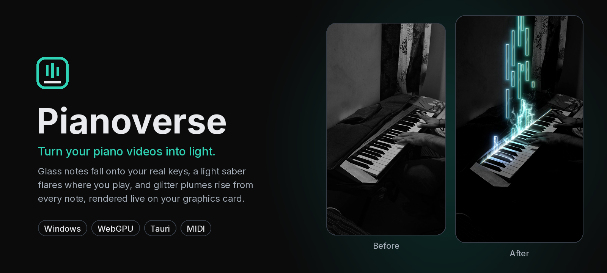
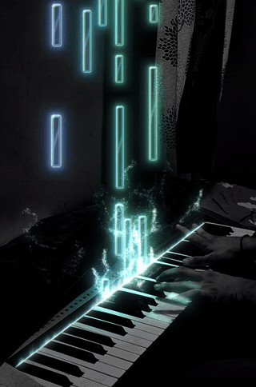
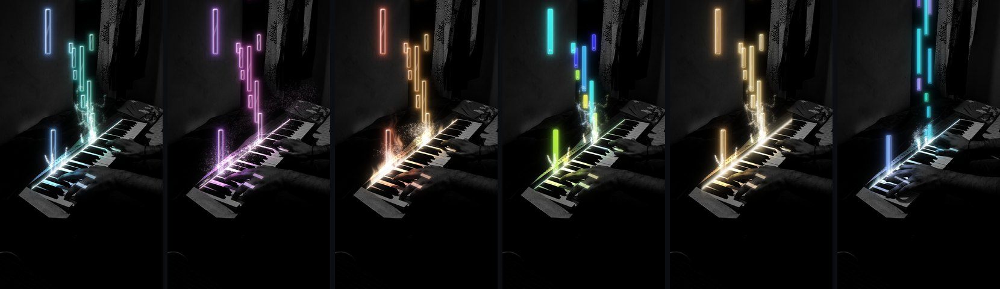
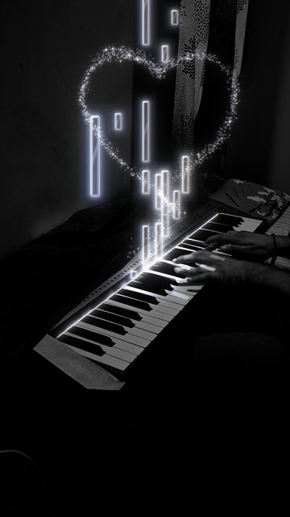
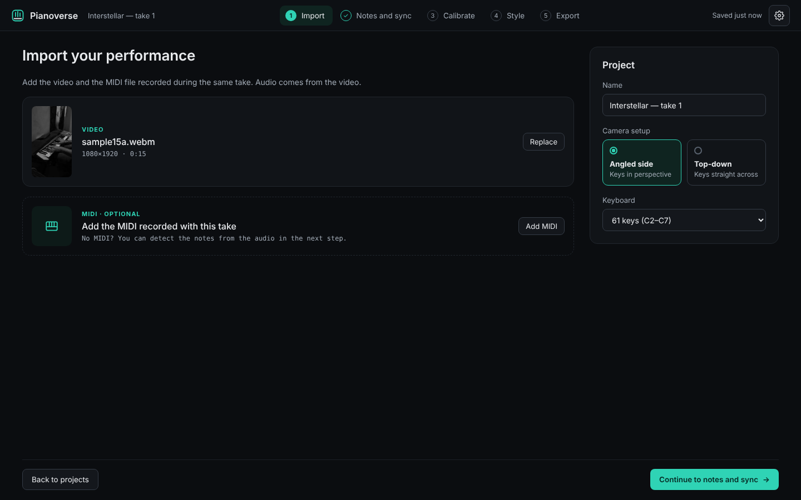
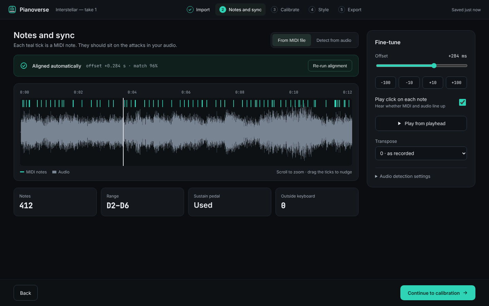
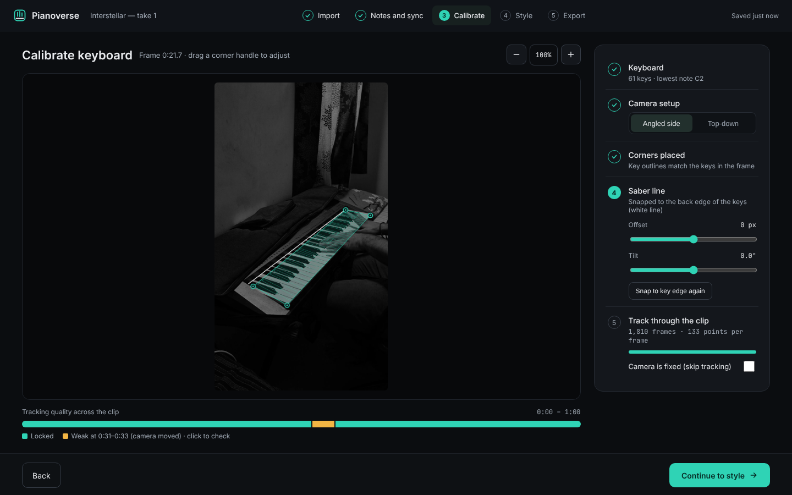
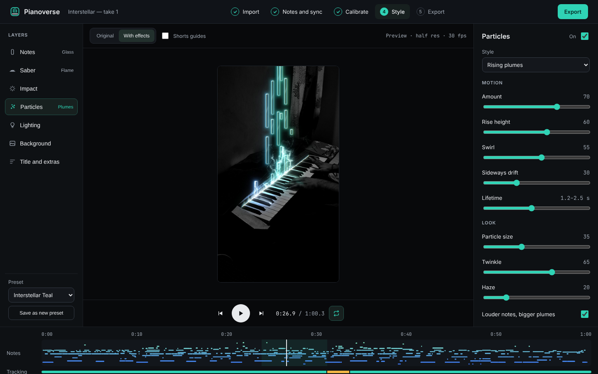
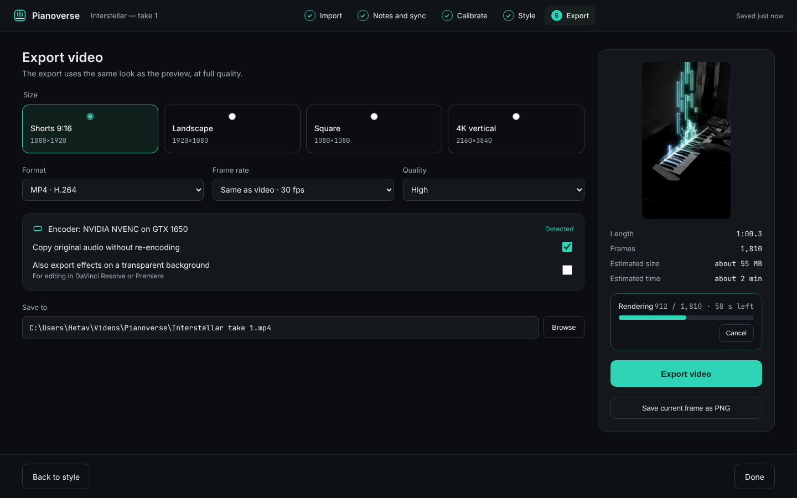
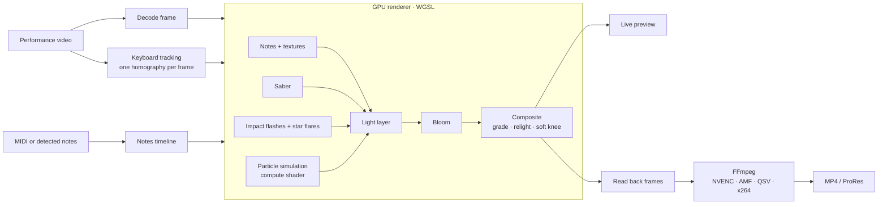

<p align="center">
  
</p>

<p align="center">
  <a href="https://github.com/HetavShah/pianoverse/actions/workflows/build.yml"></a>
  <a href="https://github.com/HetavShah/pianoverse/releases/latest"></a>
  
  
  
  
</p>

<h3 align="center">Falling notes on your real keys.</h3>

<p align="center">
  Add your piano video and its MIDI. Pianoverse drops every note onto the key you pressed,<br>
  lights up your keys and sends sparks flying, then exports it for Shorts, Reels or YouTube. For Windows.
</p>

<p align="center">
  <a href="https://github.com/HetavShah/pianoverse/releases/latest"><b>Download for Windows</b></a>
</p>

---

## See it move

<table>
  <tr>
    <td width="40%" align="center"></td>
    <td width="60%" valign="top">

### What happens on screen

**Notes** — glass, gem, round, solid, outline or soft-glow bars, with real textures inside if you like. Their length is how long you held the key; the sustain pedal can stretch them.

**Saber** — a glowing line along the back edge of your keyboard, where the notes land. It brightens at each key you play, in that note's colour. Plasma, straight, electric, soft beam or flame.

**Particles** — each note sends small sparks up from its key. They can rise in plumes, arc like a fountain, spray from held notes, spiral in a vortex, or trace a shape such as a heart.

**Lighting** — each note lights its key and casts its colour onto your fingers. Louder notes are brighter, held keys stay lit, and bass notes briefly brighten the whole frame.

**Keyboard tracking** — Pianoverse finds the keyboard in every frame, so the notes stay on the right keys even if the phone moves.

  </td>
  </tr>
</table>

---

## One take, six looks

<p align="center">
  
</p>

<p align="center"><sub>The same moment, rendered by Pianoverse: Interstellar Teal · Neon (electric saber, vortex) · Ember (flame saber, fountain) · Twelve colours (solid notes, note names) · Gold foil texture · Aurora (gem notes, held-note spray)</sub></p>

Every look is made in the **Style** step, where each layer has its own panel:

| Layer | What you can change |
| --- | --- |
| **Colours** | 1 colour, 12 colours (one per note name), gradient across the keyboard (by pitch, loudness or time), MIDI tracks, MIDI channels, a split for left and right hand, or random. Twelve palettes plus a colour wheel. |
| **Notes** | Style (Glass, Gem, Round, Solid, Outline, Soft glow), size, rounding, rim, glow, opacity, lighting. Textures: Ice, Onyx, Marble, Gold foil, a moving Crystal flow, or your own image or video. Note names and bar lines. |
| **Saber** | Plasma, Straight, Electric, Soft beam or Flame; brightness, thickness, flicker, how much it reacts, height on the keys, its own colour. |
| **Impact** | Flash size and brightness, streak length, how long the flash lasts. |
| **Particles** | Presets (Explode, Fast playing, High count, High turbulence, Twirl …) and motions: Plumes, Fountain, Held-note spray, Vortex, Shape. Turbulence, gravity, wind, lifetime, size, twinkle, haze. |
| **Lighting** | Key glow, glow before a note lands, coloured light on hands and keys, bass pulse. |
| **Background** | Your footage (darken, contrast, saturation, vignette), a plain colour, or an image of your own with its own position and colour controls. |
| **Glow and film** | Bloom, wide bloom, colour fringe and film grain. |

Save a look as a preset and reuse it on the next video.

<table>
  <tr>
    <td width="30%" align="center"></td>
    <td width="70%" valign="middle">

### Shape sections

Pick a stretch of the timeline and the sparks from the notes played there trace a shape: they leave the keys, travel round the outline clockwise or anticlockwise, and fade as they close it. The rest of the video keeps its normal particles, and you can keep the normal particles inside the section too. Built-in shapes or your own SVG.

  </td>
  </tr>
</table>

---

## From video to visualizer

<table>
  <tr>
    <td width="50%"><br><b>1 · Import and Video</b> — drop in the performance video, pick the camera setup and keyboard size, then trim and crop it.</td>
    <td width="50%"><br><b>2 · Audio</b> — the MIDI lines itself up with the audio; check it by ear and nudge it to the millisecond. No MIDI? Detect the notes from the audio. On <b>Sound</b>: play your notes on a recorded concert grand (with the sustain pedal) instead of, or under, your video's sound; an intro and outro (fade, open up, swell; fade, muffle, ring out); reverb rooms from a studio to a cathedral; EQ; and loudness matched to social media.</td>
  </tr>
  <tr>
    <td width="50%"><br><b>3 · Calibrate</b> — drag four corners onto the keys once; the keyboard is tracked through the whole clip.</td>
    <td width="50%"><br><b>4 · Style</b> — every layer has its own panel, the preview plays live while you tweak, and the timeline holds shape sections and loop ranges.</td>
  </tr>
  <tr>
    <td colspan="2"><br><b>5 · Export</b> — Shorts, landscape, square or 4K vertical, encoded on your graphics card.</td>
  </tr>
</table>

### Export

| | |
| --- | --- |
| **Sizes** | Shorts 1080×1920 · Landscape 1920×1080 · Square 1080×1080 · 4K vertical 2160×3840 — crop to fill or fit inside |
| **Encoder** | NVIDIA NVENC, AMD AMF or Intel Quick Sync, detected automatically; x264 / x265 on the processor otherwise |
| **Format** | MP4 in H.264, or H.265 for smaller files; quality High, Medium or Small file |
| **Frame rate** | Same as the video, or 24, 30 or 60 fps |
| **Sound** | The original audio, copied without re-encoding when it is AAC, otherwise converted at high quality; with Sound settings (or the grand piano), rendered and encoded at high quality |
| **For editors** | The effects alone on a transparent background, as ProRes 4444 `.mov`, for DaVinci Resolve or Premiere |
| **Extras** | Export only the part picked on the timeline · save the current frame as a PNG · show the file in its folder |

---

## How it works



A few ideas that make it work:

- **Keyboard-space geometry.** Every key, the saber line and every landing point are defined on the keyboard plane and projected into the frame with that frame's tracked homography, so effects stay glued to the keys even when the camera drifts.
- **Stateless particles.** A particle's position at time *t* is recomputed from the moment its note was hit, inside a compute shader. Any frame can be drawn on its own, which makes scrubbing instant and export identical every time.
- **Soft blending.** Effects are drawn in an HDR light layer with bloom, then blended in with a soft knee so bright moments do not turn your hands white.
- **One engine everywhere.** The same WGSL shaders drive the live preview and the export. Export renders each frame offscreen at the output size, reads it back and pipes the raw pixels to FFmpeg, which encodes on the graphics card when it can.

---

## Roadmap

- [x] **Milestone 1 — Engine prototype.** GPU renderer reproduces the approved look on the sample video, live.
- [x] **Milestone 2 — Calibration and tracking.** Mark four corners on any frame, built-in keyboard tracker (drift-free, sub-pixel), manual fixes that blend into neighbouring frames, any keyboard size from 25 to 88 keys.
- [x] **Milestone 3 — Notes and sync.** MIDI import (tempo maps, velocities, sustain pedal), automatic alignment to the video's audio within a few milliseconds, sync strip with nudging, note detection from audio with Spotify's basic-pitch for videos without MIDI.
- [x] **Milestone 4 — Style panels and presets.** Eight layers with live controls, note styles and textures, colour modes and palettes, five saber styles, particle motions and shape sections, presets.
- [x] **Milestone 5 — Export.** Full-quality render with NVENC / AMF / Quick Sync encoding, four sizes, H.264 and H.265, original audio, transparent ProRes effects, selected part only, PNG frames.
- [ ] **Milestone 6 — Polish.** Signed installer, auto-update, autosave, undo and redo, and keyboard shortcuts (press <kbd>?</kbd> in the app) are in; speed tuning is next.
- [x] **Milestone 7 — Camera.** A virtual camera over your video: Wide, Follow your hands and Close-up shots, Cut, Glide, Punch, Dip to black and Dip to white transitions on the beat, Auto camera, and vertical, landscape or square frames. Effects stay sharp when zoomed.

**Later:** notes that pass behind your hands · picture shapes and a drawing canvas for particle paths · live mode for streaming · driving a real LED strip on the keyboard · automatic Shorts cuts.

---

## Try it

1. Download the latest **`Pianoverse_…_x64-setup.exe`** from [Releases](https://github.com/HetavShah/pianoverse/releases/latest) and install it. From then on Pianoverse updates itself: when a new build is out, click **Install and restart** in the top bar.
2. Click **New project** and choose your performance video (phone videos in HEVC are converted once, on the graphics card).
3. **Video**: trim it to the part you want and crop the frame, if you like.
4. **Audio**: add the MIDI file recorded with the take; it lines itself up with the video's sound (check it by ear with **Play click on each note**). No MIDI? **Detect from audio**. On the **Sound** page, choose how the sound starts and ends and how it sounds.
5. **Calibrate**: drag the four handles onto the corners of the keys, set the saber line, and track the clip if the camera moved.
6. **Style**: play it back with every effect and shape each layer. Drag across the timeline to loop a section or add a shape section.
7. **Export**: pick a size and click **Export video**. Videos are saved in `Videos\Pianoverse` unless you choose another place.

Projects save themselves and appear on the Projects screen.

To try the sample: start a new project with `samples/interstellar-take1.mp4`, or open `samples/interstellar-take1.pvproj.json` with **Open project file…** and choose the video when asked.

| Key | Action |
| --- | --- |
| `Space` | Play / pause |
| `←` `→` | Step one frame (hold `Shift` for one second) |
| `P` | Show render stats |
| Arrow keys (Calibrate, handle selected) | Nudge the handle 1 px (`Shift` = 5 px) |
| Scroll / drag / double-click (Calibrate) | Zoom / pan / fit |

Needs Windows 10 or 11 with a DirectX 12 graphics card (developed on an NVIDIA GTX 1650).

## Build from source

On Windows, double-click **`setup-dev.cmd`** once (installs Rust and the C++ build tools), then **`dev.cmd`** to run Pianoverse in live mode: edits to the code show up in the open window.

```bash
npm install
npm run tauri dev     # desktop app with hot reload
npm run build         # type-check + production web build
```

Every push to `main` builds a signed Windows installer on GitHub Actions and publishes it as a release; installed copies of Pianoverse pick it up through the built-in updater.

<details>
<summary><b>Project layout</b></summary>

```
src/
  App.tsx          the shell: wires the session, playback, preview, autosave and shortcuts together
  engine/          everything that works without a screen
    render/        the WebGPU renderer (scene, particles, light layers, bloom, composite)
    ml/            note finders: Transkun (piano) and Basic Pitch (any instrument)
    audio/ vision/ FFT, sync and beats; keyboard tracking and key fit
    look/          look settings, colours and presets
    shaders/       WGSL
  ui/
    app/           the shell's hooks, undo history, top bar
    import/ notes/ calibrate/ style/ light/ camera/ export/ home/   one folder per screen
    components/    shared widgets      services/   storage, files, audio decoding
src-tauri/         files, FFmpeg conversion and export, updates (Rust)
test/              browser tests, including pixel-exact golden frames
```

How it fits together, the design patterns used and how to extend each part: **[ARCHITECTURE.md](ARCHITECTURE.md)**.
</details>

<details>
<summary><b>Tech stack</b></summary>

| Part | Choice |
| --- | --- |
| App shell | Tauri 2 (Rust), signed installer and auto-update |
| Interface | React + TypeScript, Vite |
| Renderer | WebGPU with WGSL shaders |
| Tracking | Built-in: pyramidal Lucas-Kanade against the marked frame + RANSAC homography, in a Web Worker |
| Notes | MIDI via @tonejs/midi, or detected from audio with Spotify basic-pitch (TensorFlow.js) |
| Export | FFmpeg with NVENC, AMF, Quick Sync or x264/x265; ProRes 4444 for transparent effects |

Note textures use CC0 materials from [ambientCG](https://ambientcg.com).

</details>

---

<p align="center"><sub>Made by Hetav Shah</sub></p>

## Credits

The grand piano is **Salamander Grand Piano V3** by Alexander Holm, licensed under [CC-BY 3.0](https://creativecommons.org/licenses/by/3.0/) (see `assets/piano/README.md`).
