<p align="center">
  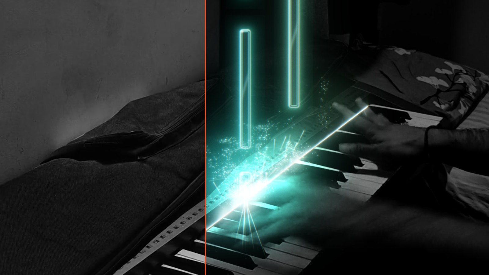
</p>

<p align="center">
  <a href="https://github.com/HetavShah/pianoverse/releases/latest"></a>
  
  
  
  <a href="https://github.com/HetavShah/pianoverse/actions/workflows/build.yml"></a>
</p>

<h1 align="center">You played it.<br>Now let them see it.</h1>

<p align="center">
  <b>The video editor made for pianists.</b><br>
  Drop in the video you filmed on your phone. Pianoverse finds every note you played and lights it up<br>
  on your own keys, with sparks, camera moves and a grand piano sound to match.
</p>

<p align="center">
  <a href="https://github.com/HetavShah/pianoverse/releases/latest"><b>Download for Windows</b></a> · <a href="https://pianoverse.in"><b>pianoverse.in</b></a>
</p>

---

## Why it exists

You nailed the take, but the video doesn't show it. A pianist has three options today, and none of them was made for pianists:

| | |
| --- | --- |
| **Post it as filmed** | Honest, but it looks like every other phone on a stand, and the phone microphone flattens the piano. |
| **Learn a video editor** | It can look amazing, after weeks of learning and hours per video, because the editor has no idea which note you played when. Every spark is placed by hand. |
| **Use a MIDI visualizer** | Beautiful falling notes, built around the MIDI file. Your footage, your room and your sound come second. |

Pianoverse starts from your video and reads your music. **A video editor sees frames. Pianoverse hears notes.** Once it knows what you played, when and how hard, every effect, every camera move and the sound can follow the music on their own.

<table>
  <tr>
    <td width="42%"></td>
    <td width="58%" valign="top">

**Notes** fall onto the key you pressed. Their length is how long you held it.

**Saber**: a glowing line along the keys, where the notes land.

**Particles**: every note throws sparks from its key; harder notes throw more.

**Light**: the keys you play light up and the room falls into shadow.

**Keyboard tracking**: the keyboard is followed frame by frame, so the notes stay on the right keys even if the phone moved.

  </td>
  </tr>
</table>

---

## Eleven looks to start. Yours to finish.

<p align="center">
  
</p>

Pick a look and the whole video changes at once. Then tune any of its nine layers and save it as your own preset, so every video on your channel looks like yours.

| Layer | What you can change |
| --- | --- |
| **Colours** | 1 colour, 12 colours (one per note name), a gradient by pitch, loudness or time, MIDI tracks or channels, left and right hand, or random. Palettes plus a colour wheel. |
| **Notes** | Glass, Gem, Round, Solid, Outline or Soft glow; size, rounding, rim, glow; textures (Ice, Onyx, Marble, Gold foil, a moving Crystal flow, or your own image or video); note names and bar lines. |
| **Saber** | Plasma, Straight, Electric, Soft beam or Flame; brightness, thickness, flicker, its own colour. |
| **Impact** | The flash and ripple on every key press. |
| **Particles** | Presets (Explode, Fast playing, High count, High turbulence, Long streaklets, Fountain, Held-note spray, Vortex, Twirl…), sparks, smoke, glitter or stars, turbulence, gravity, wind, size and lifetime. |
| **Lighting** | Key glow, a glow before a note lands, coloured light on hands and keys, a pulse on bass notes. |
| **Background** | Your video (darkened, tinted, vignetted), a plain colour, or an image of your own. |
| **Glow and film** | Bloom, colour fringe and film grain. |
| **Titles** | An opening title and an end card. |

<table>
  <tr>
    <td width="34%"></td>
    <td width="66%" valign="middle">

### Draw with sparks

Pick a stretch of the music on the timeline and the sparks from the notes played there gather into a shape: a heart for the chorus, a star for the last chord, your channel's logo for the outro. They leave the keys, trace the outline clockwise or anticlockwise, then fall away. Heart, star and music note are built in, or use your own image.

  </td>
  </tr>
</table>

---

## Your room becomes a stage

<p align="center">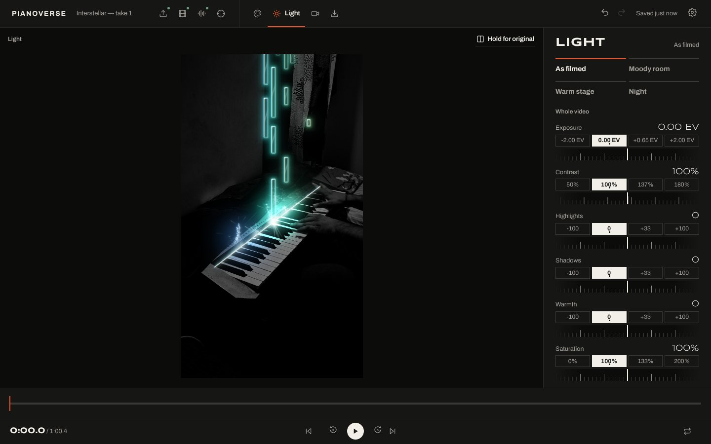</p>

Most piano videos are filmed at home under a ceiling lamp. Pianoverse lights the keys you play and lets the room fall into shadow; the notes and sparks stay bright on top. Start from **As filmed**, **Moody room**, **Warm stage** or **Night**, then adjust exposure, contrast, highlights, shadows, warmth and saturation for the whole video.

## One phone on a stand. Shot like a concert.

<p align="center">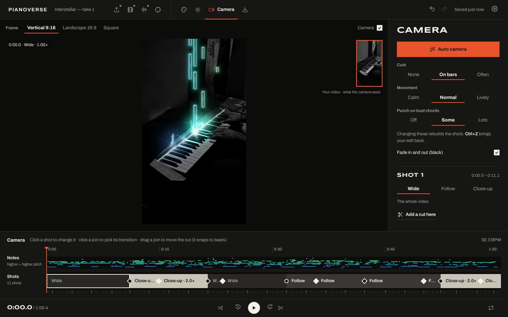</p>

You filmed one wide shot. **Auto camera** turns it into a cut: it cuts on the bar, punches in on loud chords, follows your hands up the keyboard and pulls back for the ending. Shots are **Wide**, **Follow your hands** or **Close-up**, joined by **Cut**, **Glide**, **Punch**, **Dip to black** or **Dip to white**, all snapped to the beat. Frame it **vertical 9:16**, **landscape 16:9** or **square**. Turn auto off and place every shot yourself, if you like. The effects stay sharp when the camera zooms in.

## Sound as good as it looks

<p align="center">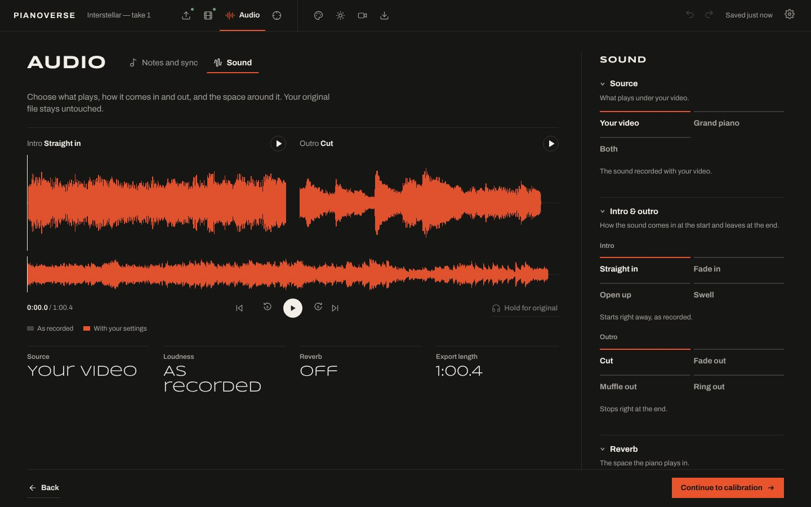</p>

A phone microphone makes a grand sound like an upright in a cupboard. Keep your own recording and give it a room, or let Pianoverse play your notes back on a sampled **concert grand**, or blend the two.

| | |
| --- | --- |
| **Sound from** | Your video · Grand piano · Both (with the piano's level) |
| **Sustain pedal** | Always down · As played · Off |
| **Intro** | Straight in · Fade in · Open up · Swell |
| **Outro** | Cut · Fade out · Muffle out · Ring out |
| **Reverb** | Studio · Concert hall · Church · Cathedral · Plate |
| **Tone and level** | Bass and treble, and loudness matched to social media (−14 LUFS) |

---

## One take, one sitting

| | | |
| --- | --- | --- |
| 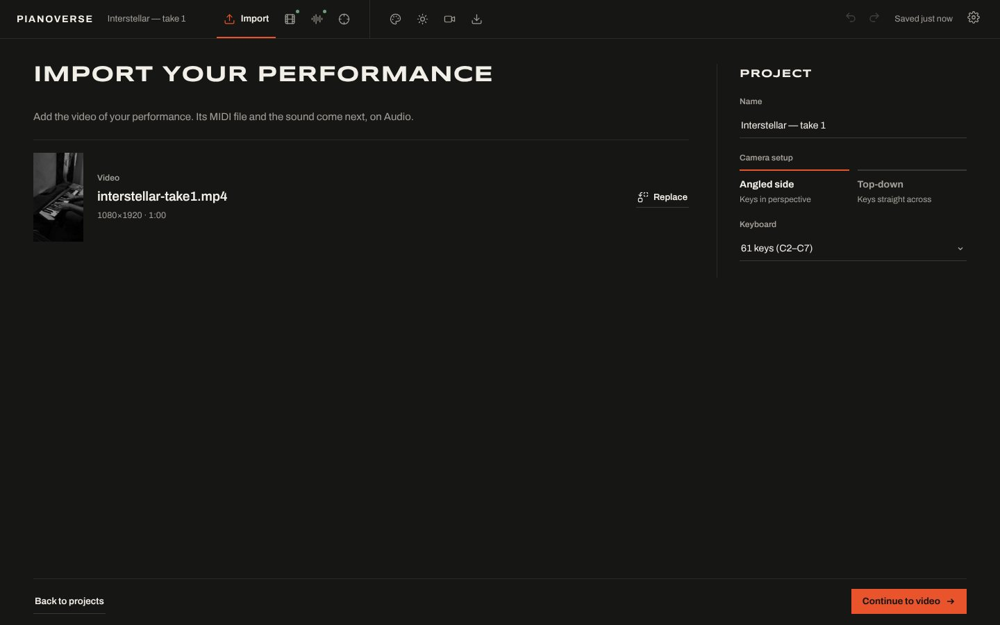<br>**1 · Import**: drop in the video from your phone and pick the keyboard. Then **Video**: trim and crop. | 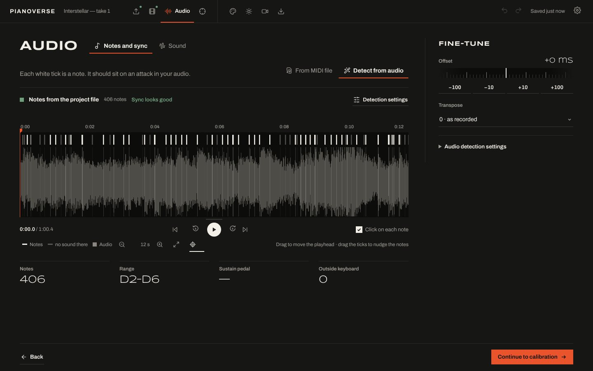<br>**2 · Audio**: add the MIDI from your piano, or let Pianoverse find the notes in the audio. They line themselves up with the video; check by ear. | 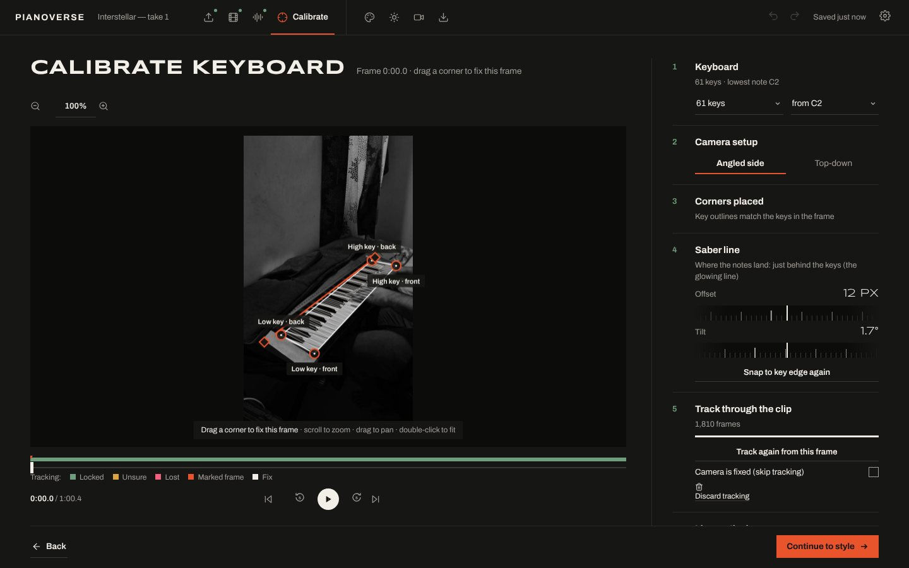<br>**3 · Calibrate**: mark the corners of the keys once. The keyboard is tracked through the whole clip. |
| 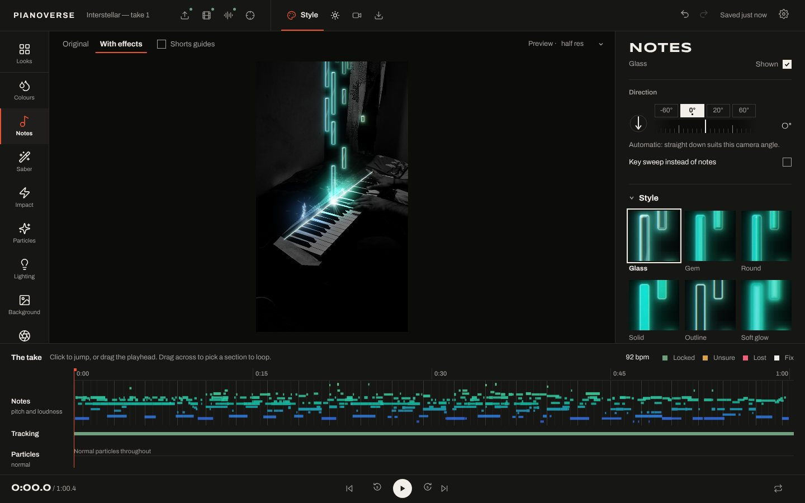<br>**4 · Style**: a look, then any layer, with the preview playing live. Then **Light** and **Camera**. | 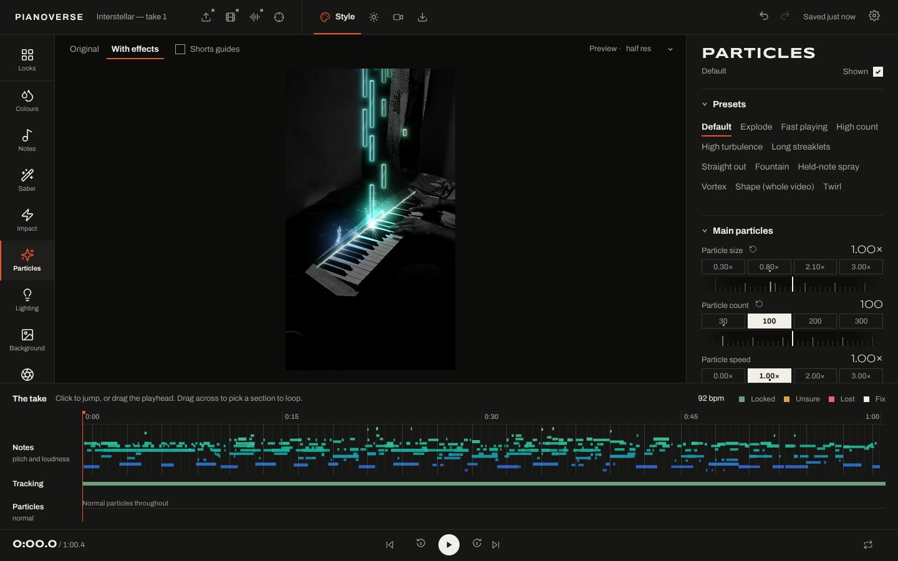<br>Every layer has its own panel; the timeline holds shape sections and loop ranges. | 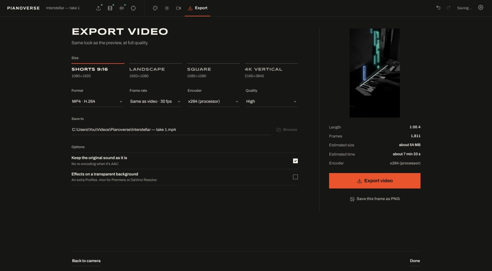<br>**5 · Export**: pick where it's going and Pianoverse sets the size, frame rate and sound level. |

### Ready for every feed

| | |
| --- | --- |
| **Sizes** | Shorts and Reels 1080×1920 · Landscape 1920×1080 · Square 1080×1080 · 4K vertical 2160×3840 |
| **Encoder** | NVIDIA NVENC, AMD AMF or Intel Quick Sync, tested in the background; x264 / x265 on the processor if the card can't |
| **Format** | MP4 in H.264, or H.265 for smaller files; quality High, Medium or Small file; frame rate as filmed, 24, 30 or 60 |
| **Sound** | Your original audio copied untouched, or the Sound settings and the grand piano rendered at high quality |
| **For editors** | The effects alone on a transparent background, as ProRes 4444 `.mov`, for DaVinci Resolve or Premiere |
| **Extras** | Export only the part picked on the timeline · save the current frame as a PNG |

---

## Made for pianists, not for editors

| | **Pianoverse** | General video editors<br><sub>Premiere Pro, After Effects, CapCut</sub> | Piano visualizers<br><sub>SeeMusic, Keysight</sub> |
| --- | --- | --- | --- |
| Starts from your own video | Yes, your take is the picture | Yes | SeeMusic: yes, over your footage. Keysight: its own 3D scene |
| Knows which note you played | Yes, from MIDI or from the audio | No, every effect is placed by hand | Yes, from MIDI. SeeMusic can also turn audio into MIDI |
| Camera moves on the music | Cuts on the bar, punches in on loud chords | By hand, with keyframes | Camera moves in their 3D piano scenes |
| Piano sound | Sampled grand, sustain pedal, reverb, loudness for social | General audio tools, no piano | Keysight makes no sound of its own |
| Price | **Free** | Premiere and After Effects: subscription. CapCut: free, Pro paid | SeeMusic: free, Pro from $8.99 a month. Keysight: $29.99 |
| Account needed | **None. No login, no sign-up** | Adobe account for Premiere and After Effects | SeeMusic: App Store. Keysight: Steam |
| Runs on | Windows 10 and 11 | Windows and Mac | SeeMusic: Mac. Keysight: Windows and Mac |

<sub>Product names belong to their owners. Checked against each product's own store page in October 2026; prices and features change.</sub>

---

## Try it

1. Download the latest **`Pianoverse_…_x64-setup.exe`** from [Releases](https://github.com/HetavShah/pianoverse/releases/latest) and install it. It's free, with no login and no sign-up. From then on Pianoverse updates itself: when a new build is out, click **Install and restart** in the top bar.
2. Click **New project** and choose your performance video. iPhone videos in HEVC are converted once, on the graphics card.
3. Go through the steps along the top: **Import**, **Video**, **Audio**, **Calibrate**, **Style**, **Light**, **Camera**, **Export**. Projects save themselves and appear on the Projects screen.
4. Videos are saved in `Videos\Pianoverse` unless you pick another place.

To try the sample: start a new project with `samples/interstellar-take1.mp4`, or open `samples/interstellar-take1.pvproj.json` with **Open project file…** and choose the video when asked.

| Key | Action |
| --- | --- |
| `Space` | Play / pause |
| `←` `→` | Step one frame (hold `Shift` for one second) |
| `Ctrl+Z` / `Ctrl+Y` | Undo / redo |
| `?` | All shortcuts |

**You need** Windows 10 or 11 (64-bit) and a graphics card that supports DirectX 12; 8 GB of memory or more is best. Developed on an NVIDIA GTX 1650.

---

## How it works

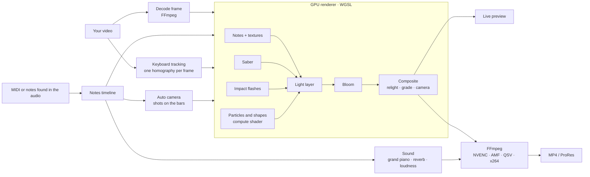

- **Keyboard-space geometry.** Every key, the saber line and every landing point live on the keyboard plane and are projected into the frame with that frame's tracked homography, so effects stay glued to the keys even when the camera drifts.
- **Stateless particles.** A particle's position at time *t* is worked out from the moment its note was hit, inside a compute shader, so any frame can be drawn on its own. Scrubbing is instant and an export looks the same every time.
- **Soft blending.** Effects are drawn in an HDR light layer with bloom, then blended in with a soft knee, so bright moments don't turn your hands white.
- **One engine everywhere.** The same shaders drive the live preview and the export. Export decodes the video with FFmpeg, renders each frame offscreen at the output size and pipes the pixels back to FFmpeg, which encodes on the graphics card when it can.

---

## Roadmap

- [x] **Engine.** The GPU renderer, live on the sample video.
- [x] **Calibration and tracking.** Four corners on any frame, a drift-free sub-pixel tracker, manual fixes, 25 to 88 keys.
- [x] **Notes and sync.** MIDI import (tempo maps, velocities, sustain pedal), automatic alignment to the video's audio, note detection from audio when there's no MIDI.
- [x] **Style.** Nine layers with live controls, eleven looks, presets, shape sections.
- [x] **Export.** Graphics-card encoding, four sizes, H.264 and H.265, transparent ProRes, PNG frames.
- [x] **Camera.** Auto camera on the beat, shots, transitions, vertical, landscape or square.
- [x] **Light.** Presets and whole-video grading; the room falls dark, the keys stay lit.
- [x] **Sound.** Sampled grand piano with the sustain pedal, intros and outros, reverb rooms, loudness for social.
- [ ] **Polish.** Signed installer, auto-update, autosave, undo and redo, shortcuts and the export lock are in; speed tuning is next.

**Later:** notes that pass behind your hands · live mode for streaming · driving a real LED strip on the keyboard · automatic Shorts cuts · a Mac version.

---

## Build from source

On Windows, double-click **`setup-dev.cmd`** once (installs Rust and the C++ build tools), then **`dev.cmd`** to run Pianoverse in live mode: edits to the code show up in the open window.

```bash
npm install
npm run tauri dev     # desktop app with hot reload
npm run build         # type-check + production web build
```

Every push to `main` builds a signed Windows installer on GitHub Actions and publishes it as a release; installed copies pick it up through the built-in updater. Changes to `README.md`, `docs/` or `website/` don't.

<details>
<summary><b>Project layout</b></summary>

```
src/
  App.tsx          the shell: session, playback, preview, autosave and shortcuts
  engine/          everything that works without a screen
    render/        the WebGPU renderer (scene, particles, light layers, bloom, composite)
    audio/         sound chain, grand piano, reverb, mixdown, loudness
    ml/            note finders: Transkun (piano) and Basic Pitch (any instrument)
    vision/        keyboard tracking and key fit
    look/          look settings, colours and presets
    shaders/       WGSL
  ui/
    app/           the shell's hooks, undo history, top bar
    import/ notes/ audio/ calibrate/ style/ light/ camera/ export/ home/   one folder per step
    components/    shared widgets      services/   storage, files, audio decoding
src-tauri/         files, FFmpeg decoding, conversion and export, updates (Rust)
website/           pianoverse.in: the page, and the tools that render its media from the app
test/              browser tests, including pixel-exact golden frames
```

How it fits together, the design patterns used and how to extend each part: **[ARCHITECTURE.md](ARCHITECTURE.md)**. The look and feel: **[DESIGN.md](DESIGN.md)**.
</details>

<details>
<summary><b>Tech stack</b></summary>

| Part | Choice |
| --- | --- |
| App shell | Tauri 2 (Rust), signed installer and auto-update |
| Interface | React + TypeScript, Vite |
| Renderer | WebGPU with WGSL shaders |
| Tracking | Pyramidal Lucas-Kanade against the marked frame + RANSAC homography, in a Web Worker |
| Notes | MIDI via @tonejs/midi, or detected from audio (Transkun, Spotify Basic Pitch) |
| Sound | Web Audio: sampled grand piano, convolution reverb, loudness in LUFS |
| Video | FFmpeg: decoding, HEVC conversion, NVENC, AMF, Quick Sync or x264/x265; ProRes 4444 for transparent effects |

</details>

---

## Credits

The grand piano is **Salamander Grand Piano V3** by Alexander Holm, licensed under [CC-BY 3.0](https://creativecommons.org/licenses/by/3.0/) (see `assets/piano/README.md`). Note textures use CC0 materials from [ambientCG](https://ambientcg.com). Video work by [FFmpeg](https://ffmpeg.org).

<p align="center"><sub>Made by Hetav Shah · <a href="https://pianoverse.in">pianoverse.in</a></sub></p>
